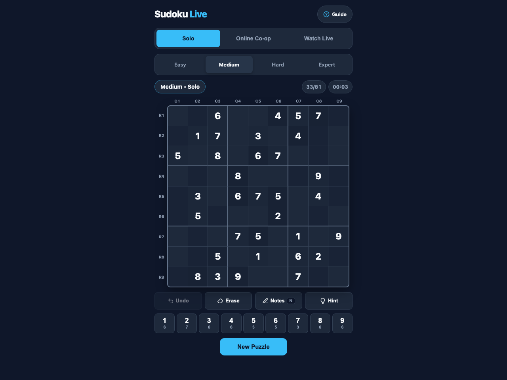
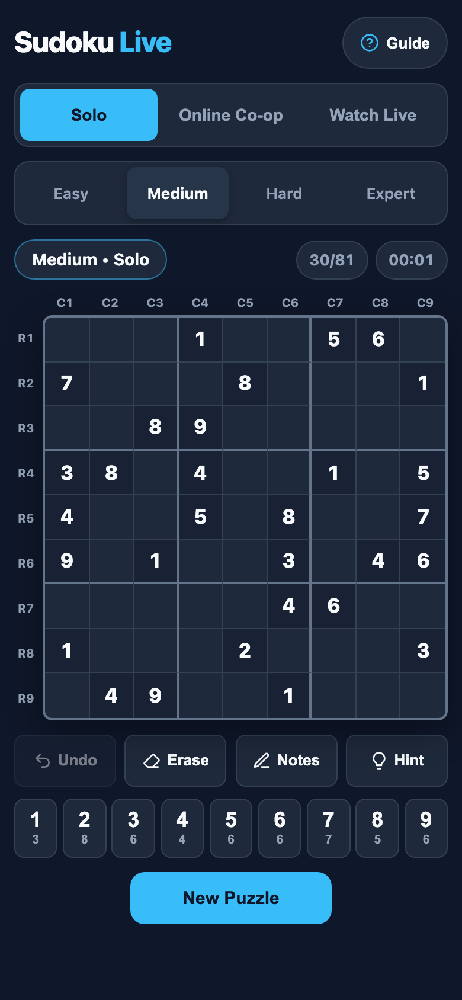

# Tic Tac Toe

A fast, lightweight, and accessible open-source Tic Tac Toe game built with Laravel 13, Native CSS, Vanilla JavaScript, and self-hosted WebSockets via Laravel Reverb.

The application is mobile-first, privacy-friendly, zero-login, targets WCAG 2.2 Level AA accessibility, and runs completely self-hosted with minimal dependencies.

---

## Screenshots

| Desktop Gameplay | Mobile Viewport |
| :---: | :---: |
|  |  |

---

## Key Features

- **Mobile-First & Touch-First**: Responsive layout with minimum 44×44px interactive touch targets, square centering, and landscape/portrait adaptation.
- **Accessible (Targeting WCAG 2.2 AA)**: Semantic HTML grid, native buttons, accessible cell coordinate labels (e.g., *"Row 1, Column 1, empty"*), `aria-live` turn and result announcements, high-contrast focus rings, visual win markers (not color alone), and `prefers-reduced-motion` support.
- **Four Game Modes**:
  1. **Local 2-Player**: Play on the same screen offline without network latency.
  2. **Computer Opponent (AI)**: Three levels (Easy, Medium, and an unbeatable Hard algorithm powered by Minimax).
  3. **Real-Time Online Multiplayer**: Zero-registration room creation, cryptographically secure invitation links, authoritative server state, and optimistic real-time sync.
  4. **Live Spectator Watch Mode**: Browse all active public online matches in real time and watch live moves as they happen.
- **Real-Time Presence & Opponent Tracking**: Instant visual indicator showing whether your opponent is connected or disconnected.
- **Live Spectator Counter**: Live count of viewers watching each game in real time.
- **Zero Database Load for Presence**: Managed entirely in-memory via Laravel Reverb Presence Channels (`presence-games.{id}`) without polling, heartbeats, or SQLite writes.
- **Zero Heavy Frontend Frameworks**: Built with pure native CSS and vanilla ES modules (no Tailwind, Bootstrap, React, Vue, or Alpine).
- **Self-Hosted Real-Time WebSockets**: Powered by Laravel Reverb without third-party hosted services or Redis dependencies.
- **ACID Persistence & Concurrency**: SQLite with atomic versioned conditional updates preventing duplicate, conflicting, or out-of-order moves.

---

## Technology Stack

- **Backend**: Laravel 13, PHP 8.4+, Laravel Reverb, SQLite
- **Frontend**: Laravel Blade, Vanilla JavaScript (ES modules), Native CSS, Laravel Echo, Vite
- **Development**: Nix (`devenv`), `direnv`, Composer, Node.js & npm
- **Testing & Quality**: PHPUnit, Vitest, Laravel Pint

---

## Requirements

- PHP 8.4 or newer with `pdo_sqlite` and `mbstring` extensions
- Composer 2.x
- Node.js 20+ and npm
- SQLite 3

Alternatively, use `devenv` / `direnv` for automated zero-install environment setup.

---

## Quick Start

```bash
# 1. Clone the repository
git clone https://github.com/haf/tictacagro.git
cd tictacagro

# 2. Install PHP and JavaScript dependencies
composer install
npm install

# 3. Prepare environment and database
cp .env.example .env
php artisan key:generate
touch database/database.sqlite
php artisan migrate

# 4. Build frontend assets
npm run build

# 5. Start development servers
# Option A: Run everything with Docker Compose (zero local dependencies)
docker compose up -d

# Option B: Start all services via devenv
devenv up

# Option C: Run commands manually in separate terminals
php artisan serve --port=8000
php artisan reverb:start --port=8080
```

Open `http://localhost:8000` in your browser.

---

## Running with Docker

A multi-stage `Dockerfile` and `docker-compose.yml` are included to run the complete stack (Web server, Reverb WebSocket server, SQLite persistence, and compiled assets) with zero local runtime dependencies.

```bash
# Build and start in background
docker compose up -d

# View service logs
docker compose logs -f

# Stop container
docker compose down
```

Open `http://localhost:8000` to play.

---

## Development Environment with devenv

A reproducible environment configuration is provided via `devenv.nix` and `.envrc`.

```bash
direnv allow
devenv up
```

`devenv up` automatically starts:
- Laravel HTTP server on `http://localhost:8000`
- Laravel Reverb WebSocket server on `ws://localhost:8080`
- Vite development asset server with Hot Module Replacement (HMR)

---

## Game Modes

### 1. Local 2-Player
Two players share one device. Turns alternate between X and O in the browser. Zero network requests required.

### 2. Computer Opponent (AI)
Play against the computer as X:
- **Easy**: Selects random available cells.
- **Medium**: Seizes immediate winning moves, blocks immediate opponent wins, and prefers the center and corners.
- **Hard**: Implements Minimax game tree evaluation. Cannot lose against any legal opponent strategy.

### 3. Online Multiplayer
- **Create**: Click *Online* to generate a new game with a unique invite URL.
- **Share**: Copy and send the link to a second player.
- **Join**: The second player opens the link and joins immediately as player O.
- **Play**: Moves are validated server-side and broadcast in real time over Reverb presence channels.
- **Opponent Status**: A presence badge shows in real time whether the opponent is currently connected (🟢) or disconnected (🔴).
- **Rematch**: Either player can request a rematch; the board resets once both agree.

### 4. Live Spectator Watch Mode
- **Browse**: Switch to the *Watch* tab to list all active games (`waiting` or `in_progress`).
- **Spectate**: Click *Watch Live* to view any running match in real time with locked controls.
- **Spectator Counter**: Real-time counter displays how many spectators are currently watching the game.

---

## Multiplayer Architecture

```
[Browser A (Host)]  -- (HTTP POST /moves) --> [Laravel Controller]
                                                     |
                                            (Validates & Updates)
                                                     v
                                             [SQLite Database]
                                                     |
                                            (Dispatches Event)
                                                     v
[Browser B (Guest)] <-- (Reverb WebSocket) <-- [Laravel Reverb]
[Spectator Browsers]<-- (Presence Channel) <-- [presence-games.{id}]
```

- **Commands via HTTP**: Move submissions, game creation, and joins are transactional HTTP requests.
- **State Notifications via WebSockets**: Committed state changes are broadcast over presence channel `presence-games.{id}`.
- **Presence & Spectators (Zero DB Load)**: Member connections, leaves, and spectator counts are tracked directly in-memory by Laravel Reverb without writing periodic heartbeats or polling SQLite.
- **Lightweight Capability Authorization**: Each player receives a cryptographically secure 256-bit token. Channel subscriptions and move commands require authorization without user registration. Anonymous spectators are granted read-only access to presence channels.
- **Concurrency & Reconnects**: SQLite uses atomic `WHERE version = :expected_version` checks. Clients refetch the authoritative state over HTTP upon reconnecting.

---

## Running Tests

Run the backend and frontend test suites:

```bash
# Run PHP backend and domain tests (40 tests)
php artisan test

# Run JavaScript frontend and client-side AI tests (13 tests)
npm run test

# Run code style checks (Laravel Pint)
./vendor/bin/pint --test
```

---

## Contributing

Please review [CONTRIBUTING.md](CONTRIBUTING.md) for branching conventions, conventional commit guidelines, and code standards.

---

## License

This project is open-source software licensed under the [MIT License](LICENSE).
